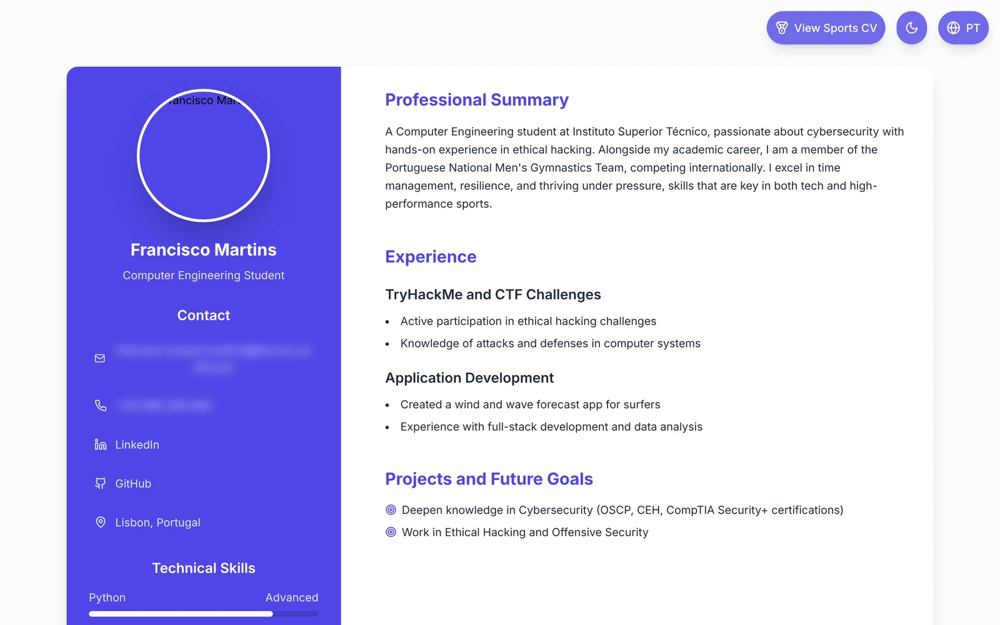

<div align="center">

# Francisco Martins · CV

**Computer engineering student at Técnico. National team gymnast.**

My curriculum as a one-page interactive website,<br>
in English and Portuguese, with a light and a dark theme, and a separate sports CV.

[](https://github.com/franciscogfsm/CV-Website/stargazers)
[](LICENSE)
[](https://github.com/franciscogfsm/CV-Website/commits)
[](https://github.com/franciscogfsm/CV-Website)

<br>



</div>

## What's on it

- **Professional summary, experience and goals.** Cybersecurity, ethical hacking and full-stack work.
- **Technical skills.** With levels, animated on scroll.
- **Sports CV.** One button switches to my gymnastics career with the Portuguese national team.
- **EN / PT.** One click to switch language.
- **Light and dark.** Follows your choice.

## Run it

```bash
npm install
npm run dev
```

| Command | What it does |
| --- | --- |
| `npm run dev` | Development server |
| `npm run build` | Production build in `dist/` |
| `npm run preview` | Serve the production build |
| `npm run lint` | Lint |

All the content lives in [`src/App.tsx`](src/App.tsx).

## Built with

React · TypeScript · Vite · Tailwind CSS · Framer Motion · Lucide

## Licence

[MIT](LICENSE) © Francisco Martins
